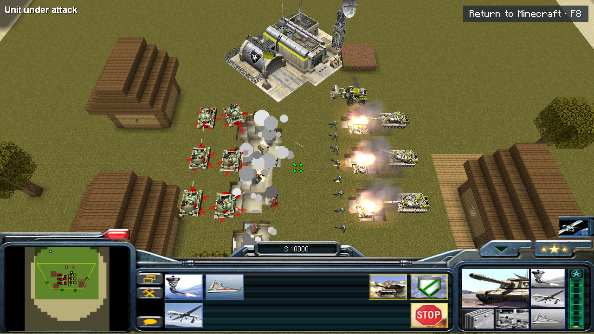
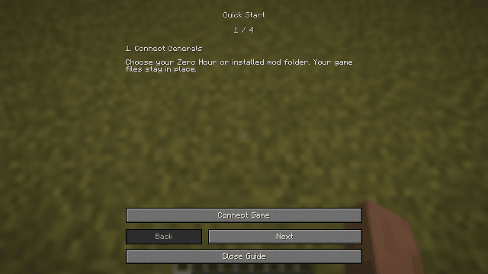
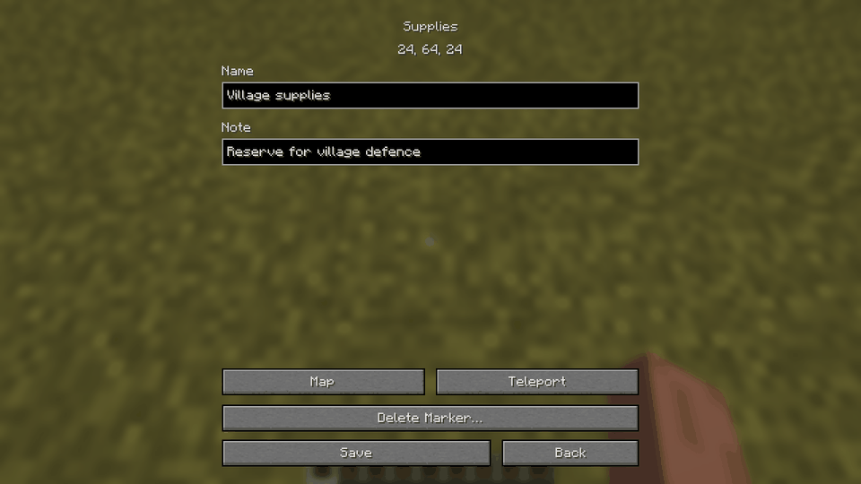

# Generals in Minecraft

**English** · [Русский](README.ru.md)



Zero Hour armies, construction and battles inside your Minecraft world. Switch between the RTS camera and ordinary Minecraft while the match keeps running.

**Beta · Fabric · Windows · Minecraft 1.21.4 / 1.21.11 / 26.x**

## Install

1. Put the mod JAR in your Fabric instance’s `mods` folder. Remove the previous Generals JAR when updating. Fabric API and the adapted engine are included.
2. Launch Minecraft → **Generals → Connect installed game**. Select your Zero Hour folder and confirm.

You need your own installed **Generals and Zero Hour**. Their files stay where they are. No installer, batch files or build tools are needed.

Open a world → pause menu → **Generals**. Choose **Start RTS here** for a local army, or **Skirmish / NPC** for a shared match. **Quick start** replays the introduction.

**F8** switches Minecraft / RTS after a match starts. **F9** opens the menu. Change these keys in Minecraft’s Controls settings. Music, effects and voices follow Minecraft’s volume controls.



## Matches and maps

Each player has a separate army. The world owner/operator creates the room; the room creator adds NPCs and starts everyone together. Choose a faction, colour, team and starting position. **+ Add NPC** adds a computer opponent. Right-click team/difficulty to cycle backwards.

**Positions** opens army placement. **Resources** shows only supplies and oil placed with markers. Drag either map and zoom with the wheel; your position is marked.

The **Generals** creative tab contains army-start, supply and oil markers. **Find markers** lists saved markers, including unloaded areas. Open a marker to name it, add a note, edit its army settings, locate it or delete it. Owners/operators and Creative players can teleport safely beside it.



**Rules** in the lobby controls block destruction, fire, mob aggression, environmental damage, general experience, victory and resource generation. Rules are saved with the world. The server owner/operator controls them.

## Games and mods

Use **+** beside the selected game to connect another installation. Selecting a game switches to it; the pencil edits its connection. A moved/deleted folder offers repair or removal. Removing a connection leaves the installed game untouched.

Vanilla Zero Hour and the installed Rise of the Reds have been tested. INI/BIG mods can use separate profiles. Mods with custom EXE/DLL changes need engine work; arbitrary mod compatibility is not guaranteed.

All participants need matching game data, engine and mod versions. Vanilla versus Contra is rejected before the match. Folder paths and player display names may differ: army ownership uses Minecraft UUIDs.

## Compatibility

- **Minecraft:** 1.21.4, 1.21.11, 26.1, 26.1.1, 26.1.2, 26.2 and 26.3. Use the JAR matching your exact version.
- **Runtime:** Java 21 for 1.21.x; Java 25 for 26.x. Fabric Loader 0.18.4+ for 1.21.4, 0.19.5+ for the other profiles. Fabric API is bundled.
- **Windows is required on clients and the server. Linux/Wine is not supported yet.**
- 26.3 includes protection for a rare Windows JVM crash during native shader compilation. It remains a beta; see [known issues](docs/KNOWN_ISSUES.md).
- RTS matches are not saved when Minecraft closes. Joining/rejoining an ongoing match, campaigns and NPC-only spectator scenarios are not ready.
- Real two-client tests on 26.3 cover eight minutes with an NPC, injected 0/100/300/0 ms RTT and recovery; a separate five-minute single-client NPC check also passes. Earlier two-client checks cover 1.21.4. Long WAN sessions, large armies and full multiplayer coverage of every profile remain to be tested.

If the engine stops, Minecraft shows a recovery screen with its logs. Connections and logs live in `%LOCALAPPDATA%/GeneralsMinecraft`; world rules and markers live in the Minecraft save. To uninstall, close Minecraft and remove the JAR.

[Install and troubleshooting](docs/INSTALL.md) · [Controls](docs/CONTROLS.md) · [Known issues](docs/KNOWN_ISSUES.md) · [Changelog](CHANGELOG.md)

## Build

**GitHub → Actions → Build mod → Run workflow** builds every verified profile, or a selected version. Download its JAR from **Artifacts**. New Minecraft versions require a port and an in-game check; entering a version number alone cannot add support.

```sh
make                       # Engine + every supported Minecraft version
make build MC=26.3         # One version
make release               # All JARs + source + checksums in dist/<version>/
make versions              # Available profiles
```

Local full builds need Windows, GNU Make, Python, Git, CMake, Visual Studio 2022 C++/Windows SDK, and JDK 21/25. Players only need the mod JAR.

[Build, version adapters and release steps](docs/DEVELOPMENT.md). A matching `v<mod_version>` tag builds a draft GitHub release; publishing stays manual. No release has been published from this workspace.

[GPL-3.0-or-later](LICENSE.md) · [Credits and third-party licences](THIRD_PARTY_NOTICES.md). Developed with AI assistance (Codex). Original game assets are read from your installation and are not distributed with the mod.
