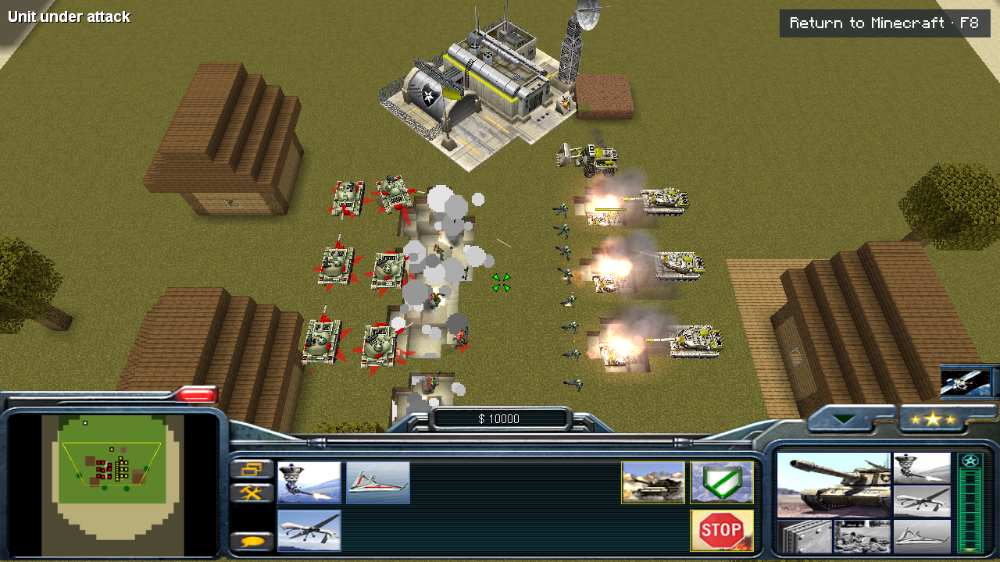
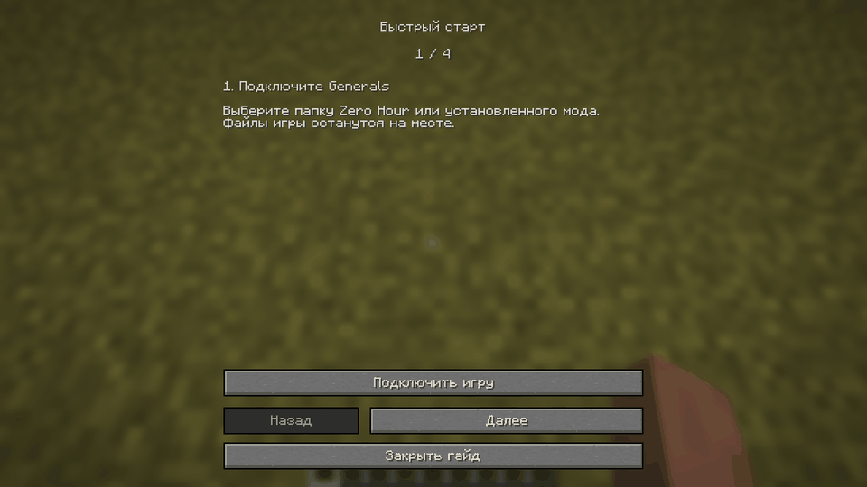
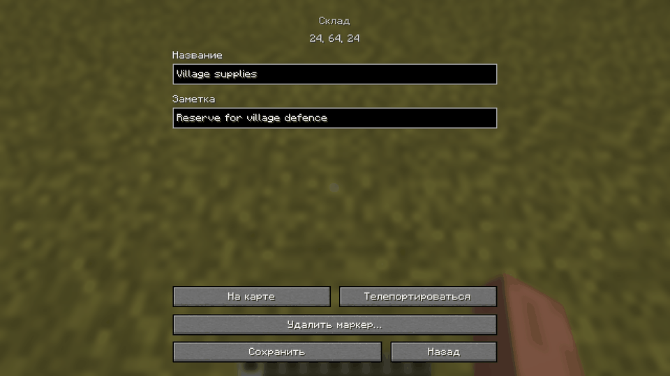
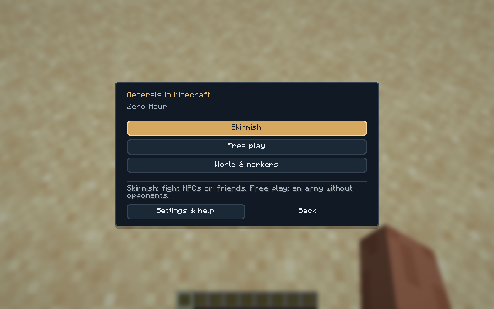
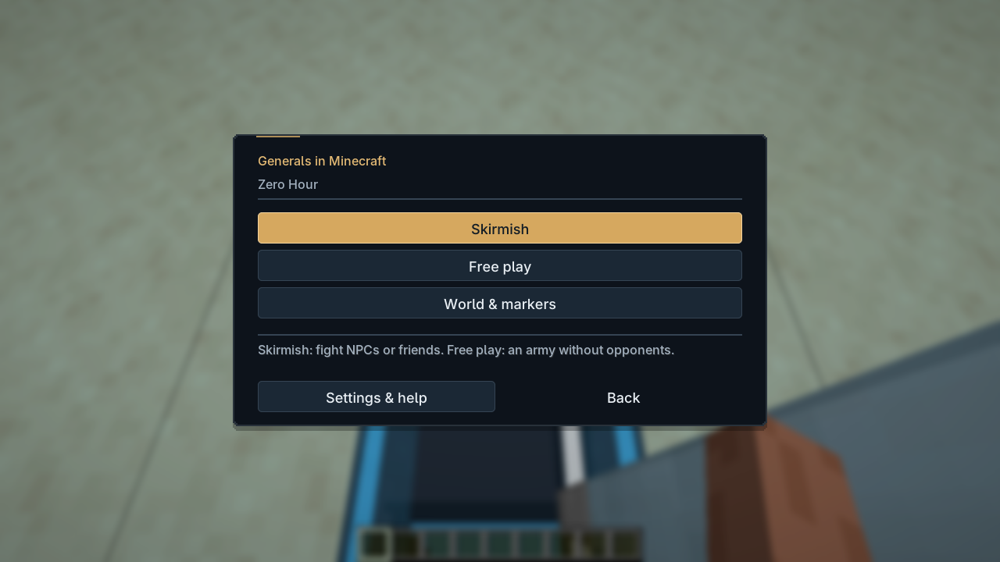

# Generals in Minecraft

[English](README.md) · **Русский**



Армии Zero Hour, строительство и сражения в мире Minecraft. Переключайтесь между камерой RTS и обычной игрой. Схватка продолжает работать.

**Бета · Fabric · Windows · Minecraft 1.21.4 / 1.21.11 / 26.x**

## Установка

1. Положите JAR мода в папку `mods` вашего профиля Fabric. При обновлении удалите предыдущий JAR Generals. Fabric API и адаптированный движок включены.
2. Откройте **Generals** в Minecraft, подключите установленную игру и выберите папку Zero Hour.

Нужны собственные установленные **Generals и Zero Hour**. Их файлы остаются на месте. Установщик, батники и инструменты сборки игроку не нужны.

В мире откройте меню паузы → **Generals**. **Свободная игра** запускает локальную армию, **Схватка** собирает общую комнату. **Настройки и помощь → Быстрый старт** повторяет краткий гайд.

**F8** переключает Minecraft / RTS после начала матча. **F9** открывает меню. Клавиши меняются в настройках управления Minecraft. Музыка, эффекты и голоса используют его настройки громкости.



## Схватки и карты

У каждого игрока своя армия. В одиночной игре **Схватка** сразу открывает комнату. На сервере комнату создаёт хост. **+ NPC** добавляет соперников. Каждый игрок нажимает **Готов**. Когда готовы все, матч начинается. Изменение настроек сбрасывает готовность. **Чат** открывает переписку комнаты. В комнате выбираются фракция, цвет, команда и стартовая позиция. **+ NPC** добавляет компьютерного противника. Нажмите поле, чтобы изменить его; имя NPC открывает сложность и удаление.

**Карта** содержит вкладки **Старты** и **Ресурсы**. Здесь выбирают позиции армий и смотрят поставленные склады и вышки. Перетаскивайте карту мышью, меняйте масштаб колесом. Стартовые деньги и лимит супероружия находятся в **Параметрах**; текущие значения видны в комнате.

Во вкладке **Generals** творческого инвентаря находятся маркеры старта армии, склада и нефтяной вышки. **Generals → Мир и маркеры → Найти маркеры** показывает сохранённые точки, включая непрогруженные области. Откройте точку, чтобы переименовать её, добавить заметку, изменить армию, найти на карте или удалить. Владелец мира, оператор и игрок в Creative могут безопасно телепортироваться к ней.

Для сбора ресурсов постройте центр снабжения, выделите чинука, грузовик или рабочего и нажмите ЛКМ по складу. В новой катке запас восстанавливается. Для нефтяной вышки нужно изучить захват зданий.

В режиме Minecraft нажмите по своей технике, чтобы сесть в неё. WASD двигает машину, камера задаёт прицел, удержание ЛКМ открывает огонь, Shift высаживает. Оранжевый прицел означает, что цель вне дальности оружия. Переназначенные клавиши описаны в [управлении](docs/CONTROLS.ru.md).



**Параметры → Правила** в комнате управляют разрушениями, огнём, агрессией мобов, уроном окружения, генеральским опытом, победой и генерацией ресурсов. Они сохраняются с миром. Менять правила может только хост схватки. На выделенном сервере он должен быть оператором.

Тёмная тема с золотыми акцентами встроена во все меню Generals. С Modern UI работают его собственные кнопки, поля ввода и эффекты нажатия. Без него тот же макет использует виджеты Minecraft. Интеграция поддерживает официальные сборки Modern UI для 1.21.4 и 26.1 по 26.1.2.

| Встроенная тема | С Modern UI |
| --- | --- |
|  |  |

## Игры и модификации

Кнопка **+** рядом с выбранной игрой подключает другую установку. Выбор игры сразу переключает профиль; карандаш изменяет подключение. Если папка перемещена или удалена, меню предлагает исправить путь или убрать подключение. Сама установленная игра при этом не удаляется.

Проверены обычная Zero Hour и установленная Rise of the Reds. Модификации с данными INI/BIG можно подключать отдельными профилями. Изменения EXE/DLL требуют поддержки движка; совместимость с любой модификацией пока не гарантируется.

В сетевой игре у всех должны совпадать игровые данные, движок и версия мода. Vanilla и Contra вместе не запустятся: проверка отклонит такое сочетание до матча. Пути к папкам и отображаемые имена игроков могут различаться. Армия привязана к UUID Minecraft.

## Совместимость

- **Minecraft:** 1.21.4, 1.21.11, 26.1, 26.1.1, 26.1.2, 26.2 и 26.3. Скачивайте JAR для точной версии игры.
- **Java:** 21 для 1.21.x; 25 для 26.x. Fabric Loader 0.18.4+ для 1.21.4, 0.19.5+ для остальных профилей. Fabric API включён.
- **Windows нужен клиентам и серверу. Linux/Wine пока не поддержаны.**
- RTS-матч пока не сохраняется между запусками Minecraft. Подключение к уже начатой схватке, кампании и наблюдение за NPC без собственной армии ещё не готовы.
- Проверки охватывают конкретные сценарии. Длительные WAN-матчи и большие армии требуют отдельной проверки. Подробнее в [известных ограничениях](docs/KNOWN_ISSUES.ru.md).

Если движок остановится, Minecraft покажет экран восстановления и путь к журналам. Подключения и журналы находятся в `%LOCALAPPDATA%/GeneralsMinecraft`, правила и маркеры хранятся в сохранении мира. Для удаления мода закройте Minecraft и уберите JAR.

[Установка и устранение ошибок](docs/INSTALL.ru.md) · [Управление](docs/CONTROLS.ru.md) · [Ограничения](docs/KNOWN_ISSUES.ru.md) · [История изменений](CHANGELOG.ru.md)

## Сборка

**GitHub → Actions → Build mod → Run workflow** собирает все поддерживаемые версии или одну выбранную. Готовый JAR находится в **Artifacts**. Новый номер Minecraft сам по себе не добавляет поддержку. Нужны адаптация и проверка в игре.

```sh
make                       # Движок + все поддерживаемые версии Minecraft
make build MC=26.3         # Одна версия
make release               # Все JAR, исходники и SHA256 в dist/<версия>/
make versions              # Список профилей
```

Для полной локальной сборки нужны Windows, GNU Make, Python, Git, CMake, Visual Studio 2022 C++/Windows SDK и JDK 21/25. Для установки готового мода они не нужны.

[Сборка, версии и выпуск релиза](docs/DEVELOPMENT.ru.md). Тег `v<mod_version>` собирает черновик релиза. Проверьте и опубликуйте его на GitHub.

[GPL-3.0-or-later](LICENSE.ru.md) · [Авторы и лицензии](THIRD_PARTY_NOTICES.ru.md). Разработано с помощью ИИ Codex. Оригинальные игровые данные читаются из вашей установки и не распространяются с модом.
